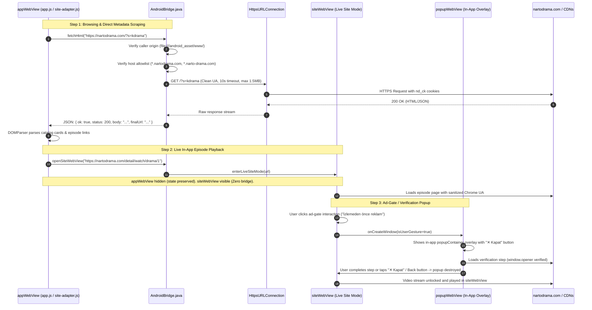

# DramaPocket — Architecture & System Design

DramaPocket is a lightweight, high-performance Android application designed for browsing, searching, and watching dramas from [NartoDrama](https://nartodrama.com). It leverages an ultra-clean, zero-dependency native Android Java Dual-WebView architecture with a local offline-capable HTML5/CSS/JavaScript client, a hardened Java bridge with complete isolation, and an in-app popup manager.

---

## 1. Architectural Philosophy: The Zero-Dependency Android Model

Modern Android applications frequently accumulate hundreds of third-party libraries, transitive dependencies, and large frameworks (AndroidX, Jetpack Compose, OkHttp, Retrofit, Kotlin stdlib, Coroutines) resulting in APK sizes exceeding 30–70 MB, slow cold starts, complex build chains, and substantial supply chain vulnerability surfaces.

DramaPocket demonstrates that using the **standard Android Framework APIs** (`minSdk 24`, `targetSdk 34`, `compileSdk 34`):
- **Zero Maven Dependencies**: The `dependencies {}` block in `app/build.gradle` is completely empty.
- **Tiny APK Footprint**: Release build compiles down to **under 1 MB**.
- **Instant Cold Starts**: No runtime dependency injection or heavy class initialization.
- **Zero Supply-Chain Risk**: Built exclusively with verified Google Android SDK platform components (`android.app.Activity`, `android.webkit.WebView`, `android.app.DownloadManager`, `java.net.HttpsURLConnection`, `org.json.JSONObject`).

```
+---------------------------------------------------------------------------------------------------+
|                                     DramaPocket APK (<1 MB)                                       |
+---------------------------------------------------------------------------------------------------+
|                                                                                                   |
|  +---------------------------------------------------------------------------------------------+  |
|  |                           Offline-Capable Frontend (Assets Layer)                           |  |
|  |   file:///android_asset/www/                                                                |  |
|  |   ├── index.html       (Turkish UI: Ana Sayfa, Ara, Favoriler, İndirilenler)                |  |
|  |   ├── css/styles.css   (Mobile-first responsive theme, Dark Slate/Indigo)                  |  |
|  |   └── js/                                                                                   |  |
|  |       ├── site-adapter.js (3-tier scraping, WP REST / DOMParser)                            |  |
|  |       ├── storage.js      (Favorites, history, continue-watching)                          |  |
|  |       └── app.js          (UI controller, modal player, back-button)                        |  |
|  +---------------------------------------------------------------------------------------------+  |
|                                                │                                                  |
|                              window.AndroidBridge (JavascriptInterface)                           |
|                                                ▼                                                  |
|  +---------------------------------------------------------------------------------------------+  |
|  |                              Dual-WebView Architecture                                      |  |
|  |                                                                                             |  |
|  |  +--------------------------------------+     +------------------------------------------+  |  |
|  |  |         appWebView (Local SPA)       |     |         siteWebView (Live Player)        |  |  |
|  |  |  - file:///android_asset/www/...     |     |  - https://nartodrama.com/...            |  |  |
|  |  |  - Has window.AndroidBridge          |     |  - ZERO JavascriptInterface (100% safe)  |  |  |
|  |  |  - Preserves user SPA DOM state      |     |  - Sanitized UA (strips ; wv)            |  |  |
|  |  |  - Never loads external web pages    |     |  - setSupportMultipleWindows(true)       |  |  |
|  |  +--------------------------------------+     +------------------------------------------+  |  |
|  |                                                                   │                        |  |
|  |                                                       onCreateWindow (User Gesture)        |  |
|  |                                                                   ▼                        |  |
|  |                                               +------------------------------------------+  |  |
|  |                                               |      In-App Popup Overlay Container      |  |  |
|  |                                               |  - Dismissible ("✕ Kapat" / Back)        |  |  |
|  |                                               |  - popupWebView (No bridge, in-app ad)   |  |  |
|  |                                               +------------------------------------------+  |  |
|  +---------------------------------------------------------------------------------------------+  |
|                     │                         │                      │                            |
|                     ▼                         ▼                      ▼                            |
|          HttpsURLConnection          DownloadManager        Storage Access                        |
|       (Allowlisted Domains)        (Public /Downloads)        Framework                           |
|                     │                         │                      │                            |
+---------------------┼-------------------------┼----------------------┼----------------------------+
                      │                         │                      │
                      ▼                         ▼                      ▼
           Allowlisted CDN/Site Hosts       DramaPocket/*.mp4        Local Storage
           - nartodrama.com               (Authorized Samples)       (Picked Videos)
           - narto-drama.com
           - nartodrama-api.online
```

---

## 2. Dual-WebView Architecture & Strict Bridge Isolation

To achieve zero security risk and optimal UX during video playback, DramaPocket segregates local application execution from remote website rendering across two dedicated `WebView` instances in `activity_main.xml` and `MainActivity.java`:

### 2.1 Primary App WebView (`webView` / `appWebView`)
- **Origin Confinement**: Loads exclusively from local storage (`file:///android_asset/www/index.html`).
- **Bridge Exposure**: Attaches `AndroidBridge` via `webView.addJavascriptInterface(androidBridge, "AndroidBridge")`.
- **Zero External Navigation**: Any main-frame navigation targeting external hosts is intercepted by `SafeWebViewClient`. Allowed NartoDrama URLs transition the app into `siteWebView` mode, while non-NartoDrama URLs are blocked. It **never** loads untrusted remote JavaScript into the same WebView that holds `AndroidBridge`.
- **State Preservation**: When `enterLiveSiteMode(url)` is invoked, `webView` is simply hidden (`View.GONE`) rather than reloaded. When the user exits live site mode, `webView` is made visible immediately (`View.VISIBLE`) with the exact drama modal, scroll position, and tab state preserved without reloading.

### 2.2 Site WebView (`siteWebView`)
- **Bridge Isolation**: **ZERO** `JavascriptInterface` instances are attached. Remote scripts on `nartodrama.com` or third-party embeds can never discover or invoke `window.AndroidBridge`.
- **User-Agent Sanitization**: Default Android WebView User-Agents contain `; wv` and `Version/4.0`, which anti-wrapper guards (such as NartoDrama's `ND-WG-PROBE`) detect to force-redirect users to `/open-in-browser` ("Open in Chrome"). `MainActivity` sanitizes the User-Agent string by stripping `; wv` and `Version/4.0 `, allowing episodes to stream smoothly within the application.
- **Third-Party Cookie Support**: Enables `CookieManager.setAcceptCookie(true)` and `CookieManager.setAcceptThirdPartyCookies(siteWebView, true)` to ensure HLS video auth tokens, CDN session tokens, and ad-gate state persist across stream segments.
- **Local File Lockdown**: Explicitly disables `setAllowFileAccess(false)`, `setAllowContentAccess(false)`, `setAllowFileAccessFromFileURLs(false)`, and `setAllowUniversalAccessFromFileURLs(false)`.

---

## 3. In-App Popup Window Management (`onCreateWindow`)

NartoDrama's streaming player and verification gate (`"İzlemeden önce reklam"`) require user interactions that trigger `window.open()` or target `_blank` anchor navigations. DramaPocket implements an in-app popup window management lifecycle:

```
[User clicks "İzlemeden önce reklam" / ad button in siteWebView]
                           │
                           ▼
     FullscreenWebChromeClient.onCreateWindow(...)
                           │
         Is isUserGesture true?
        ├── NO  ───► Block popup immediately (return false). Prevents rogue spam popups.
        └── YES ───► Create ephemeral popupWebView inside in-app popupContainer overlay:
                     • setSupportMultipleWindows(false)
                     • ZERO JavascriptInterface attached
                     • User-Agent sanitized (no ; wv)
                     • Allow third-party cookies
                     • Bind PopupWebViewClient & onCloseWindow callback
                           │
            What is the destination URL?
            ├── On allowlisted host (*.nartodrama.com, *.narto-drama.com):
            │   ──► Navigate siteWebView directly to URL and close popup overlay.
            └── Third-party ad-gate verification page:
                ──► Renders safely inside in-app popupContainer.
                    User interacts with verification step; window.opener receives callback.
                    User dismisses overlay anytime via "✕ Kapat" button or hardware Back button.
                    Never launches external Chrome!
```

---

## 4. Safe URL Interception & Sandboxing

### 4.1 Domain Allowlist
DramaPocket recognizes the complete operational domain footprint of NartoDrama via `isAllowedSiteHost(String host)`:
- `nartodrama.com` and `*.nartodrama.com` (main portal & web app)
- `narto-drama.com` and `*.narto-drama.com` (video streaming servers & CDNs)
- `nartodrama-api.online` and `*.nartodrama-api.online` (media API & image CDNs)

### 4.2 Scheme Filtering
- **Allowed Schemes**: `https://` (secure web content), `file:///android_asset/www/` (local app package), and `content://` (picked user video files via Storage Access Framework).
- **Blocked Schemes**: Dangerous schemes (`intent://`, `market://`, `javascript:`, `file://` outside assets, `tel:`, `mailto:`, cleartext `http://`) are strictly rejected without launching external device applications.
- **Subframe Freedom**: `SafeWebViewClient` and `SiteWebViewClient` allow sub-frames (`!request.isForMainFrame()`) to load HTTPS media and embeds without kicking the user out to Chrome.
- **Wrapper-Guard Interception**: `SiteWebViewClient` intercepts any navigation containing `open-in-browser` to prevent fallback loops, keeping the user seamlessly on their episode.

---

## 5. Component Architecture & System Data Flow



---

## 6. The 3-Tier Transport Strategy

Because NartoDrama is an external web property that may apply Cross-Origin Resource Sharing (CORS) limits or Cloudflare challenge pages, DramaPocket implements a resilient 3-tier transport strategy in `site-adapter.js`:

1. **Tier 1 (Native Bridge Fetch)**:
   - When running inside the Android app (`window.AndroidBridge.fetchHtml`), the request executes via native Java `HttpsURLConnection`.
   - This completely avoids browser/WebView CORS restrictions while keeping the host strictly allowlisted to `nartodrama.com`, `narto-drama.com`, and `nartodrama-api.online`.
2. **Tier 2 (Browser Standard Fetch)**:
   - When running in development, testing (`Node.js`/mock harness), or standalone browser environments, uses standard `window.fetch()` with an `AbortController` 10-second timeout.
3. **Tier 3 (In-App Live Site Mode / Fallback)**:
   - Detail pages provide in-app live site mode via `openSiteWebView(url)`, switching to `siteWebView` with a persistent `"← DramaPocket'a Dön"` bar.

---

## 7. Security Sandbox & Hardening

DramaPocket enforces a strict Defense-in-Depth model:

| Risk Category | Threat / Vulnerability | Mitigation in DramaPocket |
| :--- | :--- | :--- |
| **Bridge Hijacking** | Remote scripts calling native Java bridge | **Dual-WebView Architecture**: `AndroidBridge` attached ONLY to `appWebView`. `siteWebView` has zero bridges. Origin check in `AndroidBridge.isCallerAllowed()` enforces `file:///android_asset/www/`. |
| **Wrapper Detection Loop** | NartoDrama detects WebView and forces external Chrome | Clean User-Agent in `siteWebView` strips `; wv` and `Version/4.0 `. Subframes allowed; `/open-in-browser` intercepted. |
| **Ad-Gate Lockout** | Unhandled `window.open()` blocking episode unlock | `onCreateWindow` displays user-gesture popups inside in-app dismissible `popupContainer` overlay with `window.opener` compatibility. |
| **Cleartext Leaks** | Unencrypted HTTP communication | `android:usesCleartextTraffic="false"` in `AndroidManifest.xml`. Scheme checks in all WebView clients reject non-`https://`. |
| **Cross-Origin File Stealing** | Malicious script accessing device files | `WebSettings.setAllowFileAccessFromFileURLs(false)` and `setAllowUniversalAccessFromFileURLs(false)` across all WebViews. |
| **SSRF / Host Spoofing** | Script instructing bridge to fetch internal/LAN servers | Strict host allowlist in `isAllowedSiteHost()`: only `nartodrama.com`, `narto-drama.com`, `nartodrama-api.online` and subdomains. |
| **SSL/TLS Man-in-the-Middle** | Insecure certificate bypass | `SafeWebViewClient`, `SiteWebViewClient`, and `PopupWebViewClient` all call `handler.cancel()`. `handler.proceed()` is NEVER called. |
| **Directory Traversal** | Malicious filename writing to arbitrary paths | `AndroidBridge.sanitizeFileName()` strips `../`, separators, and non-alphanumeric characters, and forces `.mp4`/`.webm`/`.mkv` under `Environment.DIRECTORY_DOWNLOADS/DramaPocket/`. |
| **Denial of Service / OOM** | Massive response payload crashing app | `AndroidBridge.fetchHtml()` caps read stream to **1.5 MB** with strict 10s timeouts. |

---

## 8. JavaScript Bridge API (`window.AndroidBridge`)

| Method Signature | Return Type | Description & Security Checks |
| :--- | :--- | :--- |
| `fetchHtml(urlString)` | `String` (JSON) | HTTPS GET request to allowlisted NartoDrama hosts via `HttpsURLConnection`. Origin-verified, max 1.5 MB limit, 10s timeout. Returns `{ok, status, body, finalUrl}`. |
| `enqueueDownload(urlString, title, fileName)` | `String` (JSON) | Enqueues HTTPS download via system `DownloadManager`. Path-sanitized, saved in `DramaPocket/`. Returns `{ok, downloadId, fileName}`. |
| `getDownloadsStatus()` | `String` (JSON array) | Queries `DownloadManager.Query` for all app-managed downloads. Returns `[{downloadId, title, status, bytesDownloaded, bytesTotal, progress, localUri, reason}]`. |
| `cancelDownload(downloadId)` | `boolean` | Cancels and removes download record and temporary files via `downloadManager.remove()`. |
| `openExternalUrl(urlString)` | `void` | Validates `https://` and explicitly launches `Intent.ACTION_VIEW` in external browser (user-triggered only). |
| `openSiteWebView(urlString)` | `void` | Loads live NartoDrama page in `siteWebView` and displays persistent native return button. |
| `returnToApp()` | `void` | Hides `siteWebView` and restores `appWebView` with its exact DOM state intact. |
| `pickLocalVideo()` | `void` | Launches system Storage Access Framework (`video/*`) and delivers URI to `window.onLocalVideoSelected(uri)`. |
| `getAppInfo()` | `String` (JSON) | Returns `{versionName: "1.0.0", sdkInt: Build.VERSION.SDK_INT, platform: "android"}`. |

---

## 9. 4-Stage Android Back Button Coordination

Back navigation follows a prioritized 4-stage hierarchy in `MainActivity.onBackPressed()`:

```
[User presses Back Button]
         │
         ▼
[Stage 1: Is fullscreen video active?] ─── YES ───► Hide customView, exit fullscreen, consume back.
         │ NO
         ▼
[Stage 2: Is in-app popup overlay visible?] ─ YES ──► closePopup(): destroy popupWebView, dismiss overlay.
         │ NO
         ▼
[Stage 3: In Live Site Mode?] ─────────── YES ───► If siteWebView.canGoBack() -> siteWebView.goBack()
         │ NO                                      Else -> exitLiveSiteMode() and restore appWebView.
         ▼
[Stage 4: In Local App UI] ───────────────► Evaluate window.handleAndroidBack() in frontend JavaScript:
                                           • If modal / player / search open: closes modal, returns true.
                                           • If on sub-tab or detail view: returns to Ana Sayfa, returns true.
                                           • If on Ana Sayfa root: returns false.
                                           ▼
                                     [Did JS return true?]
                                     ├── YES: Back press consumed by UI.
                                     └── NO : Calls Activity.super.onBackPressed() (exits app).
```

---

## 10. Media Playback & Download Policy Architecture

1. **NartoDrama Stream vs Download Policy**:
   - NartoDrama embeds dynamic video players and explicitly disclaims offline downloads in their FAQ.
   - Detail pages play available streams inline or via in-app `siteWebView` live site mode. The download button displays a truthful informational notice (`"NartoDrama yayın politikası gereği çevrimdışı indirme desteklenmemektedir."`).
2. **Authorized Public-Domain Samples**:
   - DramaPocket provides an authorized sample library with open-licensed MP4 test streams (Creative Commons / Public Domain Wikimedia/W3C) to demonstrate the native Android `DownloadManager` and offline video playback pipeline.
3. **Local Storage Playback**:
   - Users can play any locally downloaded video or import existing videos from their device using the Android Storage Access Framework (`pickLocalVideo()`).
