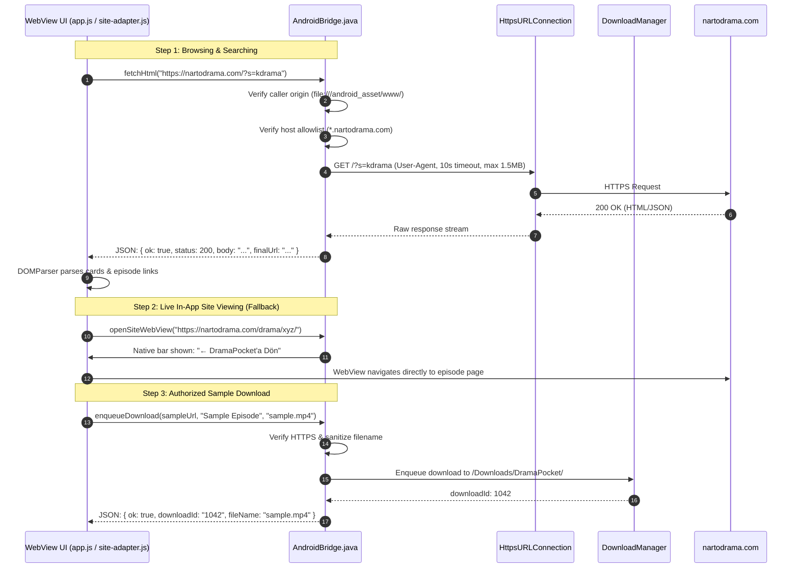

# DramaPocket — Architecture & System Design

DramaPocket is a lightweight, high-performance Android application designed for browsing, searching, and watching dramas from [NartoDrama](https://nartodrama.com). It leverages an ultra-clean, zero-dependency native Android Java WebView architecture with a local offline-capable HTML5/CSS/JavaScript client and a hardened Java bridge.

---

## 1. Architectural Philosophy: The Zero-Dependency Android Model

Modern Android applications frequently accumulate hundreds of third-party libraries, transitive dependencies, and large frameworks (AndroidX, Jetpack Compose, OkHttp, Retrofit, Kotlin stdlib, Coroutines) resulting in APK sizes exceeding 30–70 MB, slow cold starts, complex build chains, and substantial supply chain vulnerability surfaces.

DramaPocket demonstrates that using the **standard Android Framework APIs** (`minSdk 24`, `targetSdk 34`, `compileSdk 34`):
- **Zero Maven Dependencies**: The `dependencies {}` block in `app/build.gradle` is completely empty.
- **Tiny APK Footprint**: Release build compiles down to **under 1 MB**.
- **Instant Cold Starts**: No runtime dependency injection or heavy class initialization.
- **Zero Supply-Chain Risk**: Built exclusively with verified Google Android SDK platform components (`android.app.Activity`, `android.webkit.WebView`, `android.app.DownloadManager`, `java.net.HttpsURLConnection`, `org.json.JSONObject`).

```
+-----------------------------------------------------------------------------------+
|                                DramaPocket APK (<1 MB)                            |
+-----------------------------------------------------------------------------------+
|                                                                                   |
|  +-----------------------------------------------------------------------------+  |
|  |                 Offline-Capable Frontend (Assets Layer)                     |  |
|  |   file:///android_asset/www/                                                |  |
|  |   ├── index.html       (Turkish UI: Ana Sayfa, Ara, Favoriler, İndirilenler)|  |
|  |   ├── css/styles.css   (Mobile-first responsive theme, Dark Slate/Indigo)  |  |
|  |   └── js/                                                                   |  |
|  |       ├── site-adapter.js (3-tier scraping, WP REST / DOMParser)            |  |
|  |       ├── storage.js      (Favorites, history, continue-watching)          |  |
|  |       └── app.js          (UI controller, modal player, back-button)        |  |
|  +-----------------------------------------------------------------------------+  |
|                                       │                                           |
|                     window.AndroidBridge (JavascriptInterface)                    |
|                                       ▼                                           |
|  +-----------------------------------------------------------------------------+  |
|  |                      Hardened Native Android Layer                          |  |
|  |   com.dramapocket.app                                                       |  |
|  |   ├── MainActivity.java    (Activity, SafeWebViewClient, FullscreenChrome)  |  |
|  |   └── AndroidBridge.java   (fetchHtml, enqueueDownload, getDownloadsStatus) |  |
|  +-----------------------------------------------------------------------------+  |
|                     │                         │                      │            |
|                     ▼                         ▼                      ▼            |
|          HttpsURLConnection          DownloadManager        Storage Access        |
|          (Allowlisted GET)         (Public /Downloads)        Framework           |
|                     │                         │                      │            |
+---------------------┼─────────────────────────┼──────────────────────┼------------+
                      │                         │                      │
                      ▼                         ▼                      ▼
           https://nartodrama.com        DramaPocket/*.mp4        Local Storage
           (HTML/WP REST API)         (Authorized Samples)       (Picked Videos)
```

---

## 2. Component Architecture & System Data Flow



---

## 3. The 3-Tier Transport Strategy

Because NartoDrama is an external web property that may apply Cross-Origin Resource Sharing (CORS) limits or Cloudflare challenge pages, DramaPocket implements a resilient 3-tier transport strategy in `site-adapter.js`:

1. **Tier 1 (Native Bridge Fetch)**:
   - When running inside the Android app (`window.AndroidBridge.fetchHtml`), the request executes via native Java `HttpsURLConnection`.
   - This completely avoids browser/WebView CORS restrictions while keeping the host strictly allowlisted to `nartodrama.com`.
2. **Tier 2 (Browser Standard Fetch)**:
   - When running in development, testing (`Node.js`/mock harness), or standalone browser environments, uses standard `window.fetch()` with an `AbortController` 10-second timeout.
3. **Tier 3 (In-App Live Site Mode / External Fallback)**:
   - If direct parsing fails (e.g. anti-bot challenge or site layout change), the user is presented with a non-blocking UI alert and a one-tap button:
     - In Android: `AndroidBridge.openSiteWebView(url)` switches the WebView to the live page and displays a persistent native `"← DramaPocket'a Dön"` top bar.
     - In Browser: `AndroidBridge.openExternalUrl(url)` or standard anchor open.

---

## 4. Security Sandbox & Hardening

DramaPocket enforces a strict Defense-in-Depth model:

| Risk Category | Threat / Vulnerability | Mitigation in DramaPocket |
| :--- | :--- | :--- |
| **Cleartext Leaks** | Unencrypted HTTP communication | `android:usesCleartextTraffic="false"` in `AndroidManifest.xml`. Protocol checks in `AndroidBridge` reject any non-`https://` URLs. |
| **Cross-Origin File Stealing** | Malicious script accessing device files via file URL | `WebSettings.setAllowFileAccessFromFileURLs(false)` and `setAllowUniversalAccessFromFileURLs(false)`. |
| **Untrusted Bridge Invocation** | Injected script or rogue frame calling Java methods | `AndroidBridge.isCallerAllowed()` checks `webView.getUrl().startsWith("file:///android_asset/www/")` before executing privileged methods. |
| **SSRF / Host Spoofing** | Script instructing bridge to fetch internal/LAN servers | Strict host allowlist in `AndroidBridge.isNartoDramaHost`: only `nartodrama.com`, `www.nartodrama.com`, or subdomains ending in `.nartodrama.com`. |
| **SSL/TLS Man-in-the-Middle** | Insecure certificate bypass | `SafeWebViewClient.onReceivedSslError()` explicitly calls `handler.cancel()`. `handler.proceed()` is NEVER called. |
| **Directory Traversal** | Malicious filename writing to arbitrary paths | `AndroidBridge.sanitizeFileName()` strips `../`, separators, and non-alphanumeric characters, and forces `.mp4`/`.webm`/`.mkv` extensions under `Environment.DIRECTORY_DOWNLOADS/DramaPocket/`. |
| **Denial of Service / OOM** | Massive response payload crashing app | `AndroidBridge.fetchHtml()` caps read stream to **1.5 MB** with strict 10s timeouts. |

---

## 5. JavaScript Bridge API (`window.AndroidBridge`)

| Method Signature | Return Type | Description & Security Checks |
| :--- | :--- | :--- |
| `fetchHtml(urlString)` | `String` (JSON) | HTTPS GET request to `nartodrama.com` via `HttpsURLConnection`. Origin-verified, max 1.5 MB read limit, 10s timeout. Returns `{ok, status, body, finalUrl}`. |
| `enqueueDownload(urlString, title, fileName)` | `String` (JSON) | Enqueues HTTPS download via system `DownloadManager`. Path-sanitized, saved in `DramaPocket/`. Returns `{ok, downloadId, fileName}`. |
| `getDownloadsStatus()` | `String` (JSON array) | Queries `DownloadManager.Query` for all app-managed downloads. Returns `[{downloadId, title, status, bytesDownloaded, bytesTotal, progress, localUri, reason}]`. |
| `cancelDownload(downloadId)` | `boolean` | Cancels and removes download record and temporary files via `downloadManager.remove()`. |
| `openExternalUrl(urlString)` | `void` | Validates `https://` and launches `Intent.ACTION_VIEW` in external browser. |
| `openSiteWebView(urlString)` | `void` | Loads live `nartodrama.com` in WebView and shows persistent native return button. |
| `returnToApp()` | `void` | Closes live site mode, hides top bar, and reloads `file:///android_asset/www/index.html`. |
| `pickLocalVideo()` | `void` | Launches system Storage Access Framework (`video/*`) and delivers URI to `window.onLocalVideoSelected(uri)`. |
| `getAppInfo()` | `String` (JSON) | Returns `{versionName: "1.0.0", sdkInt: Build.VERSION.SDK_INT, platform: "android"}`. |

---

## 6. Android Back Button Coordination

Back navigation follows a prioritized 4-stage hierarchy in `MainActivity.onBackPressed()`:

```
[User presses Back Button]
         │
         ▼
[Is fullscreen video active?] ─── YES ───► Hide custom view, exit fullscreen, consume back.
         │ NO
         ▼
[In Live Site Mode?]          ─── YES ───► If webView.canGoBack() -> webView.goBack()
         │ NO                             Else -> exitLiveSiteMode() and return to local app.
         ▼
[In Local App UI]             ───► Evaluate `window.handleAndroidBack()` in JavaScript:
                                   • If modal / video player / search open: closes modal and returns true.
                                   • If on sub-tab or detail view: returns to Ana Sayfa and returns true.
                                   • If on Ana Sayfa root: returns false.
                                   ▼
                             [Did JS return true?]
                             ├── YES: Back press consumed by UI.
                             └── NO : Calls Activity.super.onBackPressed() (exits app).
```

---

## 7. Media Playback & Download Policy Architecture

1. **NartoDrama Stream vs Download Policy**:
   - NartoDrama embeds third-party video players and explicitly disclaims offline downloads in their FAQ.
   - DramaPocket adheres to technical honesty: detail pages play available embeds inline or through in-app live site mode, while the download button is disabled for restricted streams with a clear informational notice (`"NartoDrama yayın politikası gereği çevrimdışı indirme desteklenmemektedir."`).
2. **Authorized Public-Domain Samples**:
   - To test and demonstrate the native Android `DownloadManager` and offline video playback pipeline, DramaPocket provides an authorized sample library with open-licensed MP4 test streams (Creative Commons / Public Domain Wikimedia/W3C).
3. **Local Storage Playback**:
   - Users can play any locally downloaded video or import existing videos from their device using the Android Storage Access Framework (`pickLocalVideo()`).
